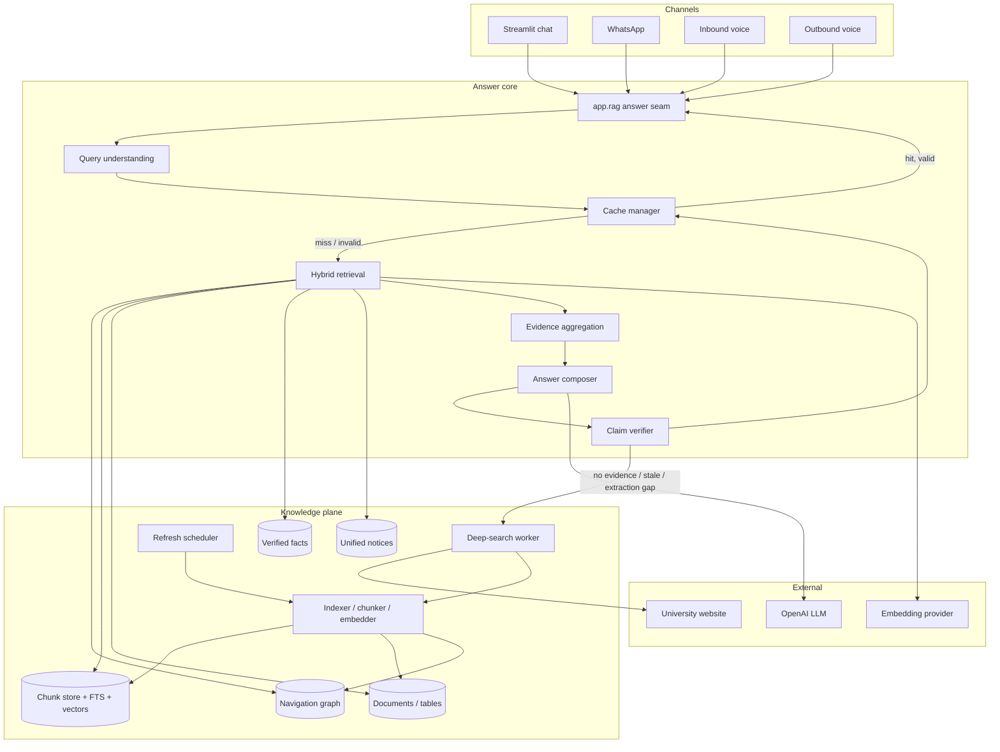
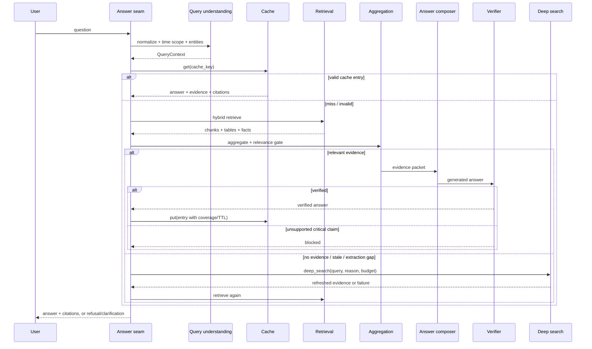
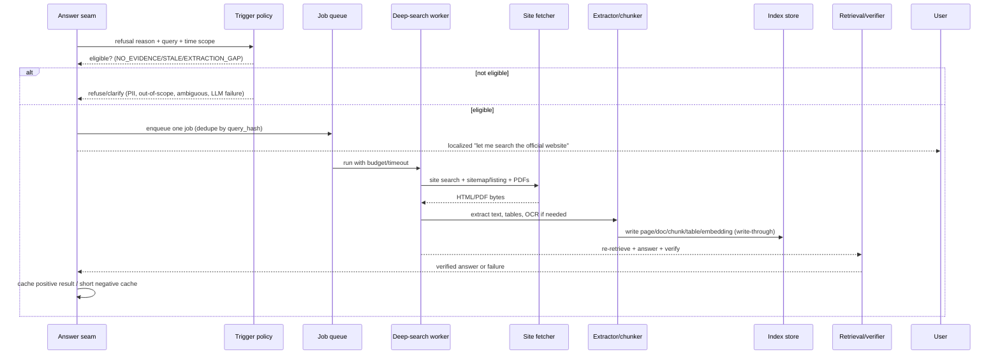

# Hybrid Retrieval, Time-Scoped Cache and Deep Search — HLD & LLD

| Field | Value |
|---|---|
| Status | **Proposed** — requires ADR approval; amends the current “No RAG” constraint |
| Date | 2026-10-31 |
| Scope | NGA text/chat/WhatsApp path, voice cache path, indexing, cache, verification |
| Related | `00-intent.md`, `01-brd.md`, `02-hld.md`, `03-lld.md`, `04-impact-analysis.md` |
| Supersedes | HLD principle P-01 “No RAG” (proposed ADR-014), cache TTL-only behaviour (ADR-016) |
| Owners | Architect, TPO, Knowledge/Content owner, Security/PII reviewer |

> **Executive summary.** The current answer path is graph + lexical FTS over a
> static snapshot. It misses facts that exist on the live site but are not
> indexed, and it can reuse a cached answer outside the time period the user
> asked about. This document specifies: (1) hybrid retrieval over a chunk
> corpus (BM25 + dense embeddings + rerank), (2) evidence aggregation and
> claim-level verification, (3) a bounded, reason-aware deep-search fallback
> that writes fetched content back into the index, and (4) a time-scoped cache
> whose validity is TTL **and** coverage **and** entity **and** source-hash
> based. It also documents every edge case and the expected behaviour.

## Implementation status (2026-10-31)

| Item | Status | Primary files | Tests |
|---|---|---|---|
| Archive/document backfill | **In progress** (index serving split; 1,516 done, 1,435 pending at checkpoint; document-only promotion live) | `scripts/nga_documents.py`, `app/sitegraph/documents.py`, `scripts/nga_promote.py` | `tests/test_nga_documents.py`, `tests/test_promote.py` |
| Deep-search fallback | **Implemented behind `DEEP_SEARCH_ENABLED`**; live search → extract → evidence → answer → verifier → answer cache. Graph write-through is still a follow-up. | `app/deepsearch/service.py`, `app/agent/text.py` | `tests/test_deepsearch.py`, `tests/test_nga_text.py` |
| Chunk + embedding hybrid | **Lexical chunk retrieval live** — 21,224 chunks, BM25+RRF fused with node ranks before truncation; level-aware search; needs_review/PII documents excluded. **Dense evaluated 2026-11-01 and not cleared** (`10-dense-evaluation.md`): hybrid hit@10 82.4% vs 90% gate, dense scan p95 3.3 s, citation drift; `EMBEDDING_PROVIDER=off` stays. Rollback is `NGA_CHUNK_RETRIEVAL_ENABLED=false`. | `app/sitegraph/chunker.py`, `indexer.py`, `hybrid.py`, `search.py`, `tools.py`, `store.py`, `scripts/nga_chunks.py`, `scripts/nga_embedding_eval.py` | `tests/test_nga_chunks.py`, `tests/test_programme_mentions.py`, `tests/test_embedding_eval.py` |
| Conditional revalidation | **Implemented and wired**; enabled in local dev `.env`, off in the example. 304 extends, 200/error invalidates; a changed source forces deep search when enabled. | `app/cache/revalidate.py`, `app/agent/text.py` | `tests/test_cache_revalidate.py` |
| Span-level verifier | **Implemented**; `[ev-N]` citations are checked against the cited item; `require_citations` is opt-in. | `app/agent/verifier.py`, `app/agent/answer.py` | `tests/test_nga_verifier.py` |

---

# Part A — High-Level Design (HLD)

## A1. Problem statement

The system must answer public, non-PII questions whose answer is published on
the university website. Today three independent failures cause misses:

1. **Coverage.** Only 157 HTML pages and 25 PDFs have body text; 158 nodes are
   `empty_shell`; 4,420 of 4,461 unique linked PDFs have no document node. The
   `archive` path token alone blocks 1,703 otherwise non-PII PDFs. The scheduler
   is off locally, so the graph is a snapshot (2026-10-26) while the live site
   changes daily.
2. **Routing/ranking.** Intent matching is exact-word (`scheduled` ≠ `schedule`);
   notice/date questions go to `site.latest` (newest 5 notices) instead of
   search; BM25 is a minor bonus and the FTS tokenizer does not stem; a generic
   token such as `university` outranks the specific schedule document.
3. **Evidence and verification.** Evidence is capped at 3 items / 3,000 chars
   per item / 4,000 chars total, tables are dropped, PDFs open at offset 0, and
   there is no relevance gate or time-scope check. A cache entry can be “fresh”
   by TTL but wrong for the requested month.

## A2. Goals and non-goals

### Goals

- Answer every **public, non-PII, accessible, extractable** question whose
  answer is published, or explicitly refuse/clarify.
- Retrieve at the **chunk** level with both lexical (BM25) and semantic
  (embedding) signals; rerank and aggregate before generation.
- Explain every answer with a source span, URL, authority and verification
  timestamp.
- Never serve a cache entry outside its validity window, including the
  requested time period, programme, exam type and source hash.
- On an eligible refusal, perform a bounded deep search of the official site,
  write the result back into the index, and answer from the refreshed evidence.
- Keep voice within its latency budget; use chat/WhatsApp for detail.

### Non-goals

- Answering student result/merit/selection/topper lists (PII policy).
- Answering login-gated portals, fees/seat data outside the verified profile,
  or content the university has not published.
- Guaranteeing that the university’s published data is itself correct.
- Unbounded crawling, scraping behind authentication, or bypassing robots.
- Replacing the navigation graph; the graph remains the provenance and
  navigation layer.

## A3. Design decisions and principles

| ID | Decision | Rationale |
|---|---|---|
| D-01 | **Hybrid retrieval** = BM25 + dense + RRF + rerank over a chunk corpus | Semantic recall for paraphrases; BM25 for exact names, dates and numbers |
| D-02 | **Chunk-first index** with page/heading/table metadata | Whole-page FTS loses the relevant section and tables |
| D-03 | **Evidence packet, not prompt stuffing** | Bounded, typed, citable evidence; the verifier can check spans |
| D-04 | **Deep search is write-through** | Fetched content becomes a page/document/chunk, so the next question uses the normal index and the answer is citable |
| D-05 | **Time-scoped cache** | TTL alone cannot distinguish Dec 2026 from Jan 2027 |
| D-06 | **Refusal taxonomy** | Not every refusal is a retrieval miss; PII/out-of-scope/ambiguous must not deep-search |
| D-07 | **Abstention is a feature** | A refusal with contact is safer than an unsupported answer |
| D-08 | **Voice stays fast** | Deep search is async/follow-up for voice; never block the call for seconds |
| D-09 | **One answer seam** | Chat, WhatsApp, voice share evidence, verifier and cache policy |
| D-10 | **Feature-flagged rollout** | `RETRIEVAL_MODE`, `DEEP_SEARCH_ENABLED`, `CACHE_BACKEND`, `VERIFY_MODE` |

> **Architecture note.** D-01 amends the existing “No RAG” principle. The
> navigation graph, authority model, citations and verifier remain; what
> changes is that retrieval may use chunk embeddings and top-k reranking.
> This requires an ADR and updates to `README.md`, `00-intent.md`,
> `02-hld.md` P-01 and `03-lld.md` §6.

## A4. System context



## A5. Components

| Component | Responsibility | Primary files (existing / new) |
|---|---|---|
| Query understanding | Normalize, spell-correct, stem, expand, parse time scope/entities/intent, decompose | `app/agent/planner.py`; new `app/agent/query.py`, `app/agent/time_scope.py` |
| Cache manager | Key, validity, TTL, revalidation, negative cache, layers | New `app/cache/answer_cache.py`, `app/cache/backends.py` |
| Hybrid retrieval | BM25 chunks + dense + RRF + rerank + filters | `app/sitegraph/search.py`, `store.py`; new `app/sitegraph/embeddings.py` |
| Evidence aggregation | Group, merge, tables, conflicts, relevance gate, budgets | `app/agent/evidence.py` |
| Answer composer | Channel/answer-shape prompts, citations, detail levels | `app/agent/answer.py`; `app/rag.py` |
| Claim verifier | Claim taxonomy, span support, entailment, rewrite/abstain | `app/agent/verifier.py`; new `app/agent/entailment.py` |
| Deep search | Trigger, site search, fetch, extract, index, re-answer | New `app/deepsearch/service.py`, `worker.py`; reuse `app/sitegraph/fetch.py`, `documents.py`, `refresh.py` |
| Indexer/chunker | HTML/PDF/table/notice chunking, embeddings, index version | New `app/sitegraph/chunker.py`, `app/sitegraph/indexer.py`; extend `store.py` |
| Refresh scheduler | Page/document/notice TTL, conditional GET, coverage | `app/sitegraph/scheduler.py`, `refresh.py`, `documents.py` |
| Policy/PII | Allowlist, student-list block, content scan, prompt injection | `app/sitegraph/policy.py`, `app/pii.py` |
| Observability | Turn events, cache/deep-search metrics, alerts | `store.py` (`nga_turn_event`), new `app/metrics.py` |
| Channels | Chat/WhatsApp/voice rendering, localization, progress | `app/rag.py`, `app/agent/text.py`, `app/agent/voice.py`, `app/localized_text.py` |

## A6. Query-to-answer flow



## A7. Deep-search flow



## A8. Cache layers and validity

| Layer | Storage | TTL | Purpose |
|---|---|---|---|
| L1 | In-process LRU | seconds–minutes | Hottest queries/config; single box |
| L2 | DB (`nga_answer_cache`) | minutes–days by content type | Durable answer/evidence cache with coverage and provenance |
| L3 | Redis (optional) | 5–60 minutes | Multi-worker hot cache, dedupe locks, rate limits |

**Validity is a conjunction:**

```
valid = status in (verified, rewritten)
        AND expires_at > now
        AND index_version == current
        AND policy_version == current
        AND source content_hash/ETag unchanged (or revalidated 304)
        AND requested time scope is covered by coverage_start/coverage_end
        AND requested entities (programme, exam_type, mode) are covered
        AND if request.after_event: event_date >= now
```

A time-scope mismatch invalidates even a fresh TTL. A Dec 2026 schedule is
never served as the answer to a Jan 2027 question.

## A9. Data model overview

- **Graph:** `nga_node`, `nga_edge` — navigation, provenance, authority.
- **Page versions:** `nga_page_version` — text, markdown, tables, sections.
- **Documents:** `nga_document` — PDF text, tables, OCR status.
- **Chunks:** `nga_chunk`, `nga_chunk_fts`, `nga_chunk_embedding`,
  `nga_table` — retrieval unit with page/heading/coverage/entities.
- **Notices:** unified notice table/chunks from current and old site.
- **Facts:** `content/dspmu/facts.json` — verified facts.
- **Answer cache:** `nga_answer_cache` — answer, evidence, coverage, TTL,
  source hashes, index/policy versions.
- **Deep search:** `nga_deep_search_job` — dedupe, status, fetched/indexed
  counts, error, result cache key.
- **Fetch state:** `nga_fetch_state` — ETag, Last-Modified, next due,
  failure count.
- **Events:** `nga_turn_event` — plan, tools, evidence, cache decision,
  retrieval scores, verification, answer status, latency.

## A10. Authority and factuality model

```
verified_fact  (signed-off facts.json)
      ▲ highest
official_page  (current CMS page)
official_document (indexed PDF)
legacy/archive (old site; labelled)
derived_summary (never a source)
      ▲ lowest
```

Rules:

- Fees, dates, contacts, named leaders: `verified_fact` wins.
- If a verified fact and a page disagree, state both and cite both; prefer the
  verified fact unless it is past `valid_until`.
- For volatile items (exam schedule), prefer the newest official document by
  `fetched_at`/`verified_at`, but only if its coverage includes the request.
- Never release an answer whose critical claim is unsupported.
- Every answer carries `authority`, `source_url`, `verified_at`, `coverage`.

## A11. PII, security and trust

- Fetched content is **untrusted data**, never instructions.
- Student result/merit/selection/topper pages and login portals are blocked
  before fetch and at answer time.
- PII scan at document ingestion and at cache write; no PII in logs/cache.
- Deep search respects robots.txt, allowlist, rate limits, max bytes/pages.
- OpenAI is the approved data boundary for LLM/embeddings; cache keys are
  hashed.
- No secrets in cache/logs; API keys remain in env.

## A12. Non-functional requirements

| Area | Requirement |
|---|---|
| Chat latency | p50 < 1.5 s, p95 < 3 s for indexed answers; deep search up to 15–30 s with a progress message |
| Voice latency | retrieval/cache < 1.5 s; no synchronous deep search; async follow-up via WhatsApp |
| Freshness | Page TTL 1 day; notices 15–60 min; exam schedules 1–6 h/daily near exam; documents 7 days or on change |
| Availability | Degrade to cached/indexed answer, then refusal with contact; never dead air |
| Cost | Embedding/LLM budget per turn; cache hits; batch indexing; local fallback optional |
| Coverage | ≥95% of in-scope public pages/PDFs indexed; coverage report by type |
| Factuality | 0 unsupported critical claims released; ≥95% claim support on golden set |
| Audit | Every answer traceable to source, chunk, fetch time, cache decision |

## A13. Failure modes and degradation

| Failure | Behaviour |
|---|---|
| Website down/timeout | No stale time-sensitive answer; refusal + contact; short negative cache |
| LLM down | Static/evidence-only fallback; no unverified generation |
| Embedding provider down | Lexical-only retrieval; log degraded mode |
| DB corrupt | Rebuild from source; serve static/refusal |
| Redis down | Fall back to DB; no data loss |
| Index stale | Deep search/refresh; label verified time |
| Cache wrong | Invalidate, reindex, audit; notify owner |
| PII leak risk | Block, log reason, incident review |
| Prompt injection | Ignore instructions, keep evidence tagged, flag source |
| Deep-search loop | One per turn; negative cache; circuit breaker |

## A14. Rollout and flags

- `RETRIEVAL_MODE=lexical|hybrid` — default `lexical` until evaluated.
- `DEEP_SEARCH_ENABLED=false|true` — chat/WhatsApp first; voice follow-up only.
- `CACHE_BACKEND=none|db|db+redis` — default `db`.
- `EMBEDDING_PROVIDER=off|openai|local`.
- `VERIFY_MODE=strict|balanced` — strict for critical claims.
- `TIME_SCOPE_STRICT=true` — never serve a mismatched scope.
- `NGA_MODE=shadow` — evaluate hybrid/deep search without changing answers.

Phases: Phase 0 (coverage/routing/table/cache schema), Phase 1 (chunk +
lexical hybrid), Phase 2 (dense + rerank), Phase 3 (deep search + voice
follow-up), each behind flags with shadow evaluation.

## A15. Risks and open questions

- **No-RAG reversal:** needs ADR and stakeholder sign-off; semantic retrieval
  can reintroduce fuzzy matches. Mitigation: chunk citations, authority,
  rerank, verifier, relevance gate.
- **Embedding cost/privacy:** cache, batch, local fallback, data-boundary
  approval.
- **PDF/table extraction quality:** OCR/review, confidence, link fallback.
- **PII vs coverage:** production guard remains; dev-only relaxed policy.
- **“Every question” is unattainable:** define in-scope corpus and SLOs;
  abstain/clarify otherwise.
- **Evaluation:** golden set, shadow mode, human audit, feedback loop.

---

# Part B — Low-Level Design (LLD)

## B0. Conventions used in this LLD

Each line item has the following hierarchy:

- **Intent** — why the item exists.
- **Work** — what must be built/changed.
- **Technical details** — data structures, algorithms, file/table/API details.
- **Edge cases** — behaviour for the scenario matrix (Part C).
- **Tests** — unit/integration/scenario tests.

All timestamps are UTC ISO-8601 (`YYYY-MM-DDTHH:MM:SSZ`). “Today/tomorrow”
are computed in `Asia/Kolkata` (IST). IDs are stable and strings.

## B1. Configuration and feature flags

### LLD-01.1 — Runtime flags
- **Intent:** Allow safe, reversible rollout of retrieval, deep search and cache.
- **Work:**
  - Add settings to `app/config.py`.
  - Document each flag in `.env.example`.
  - Validate combinations at boot (`boot_readiness`).
- **Technical details:**
  ```text
  RETRIEVAL_MODE=lexical|hybrid          # default lexical
  EMBEDDING_PROVIDER=off|openai|local   # default off
  EMBEDDING_MODEL=text-embedding-3-small
  DEEP_SEARCH_ENABLED=false|true
  DEEP_SEARCH_TIMEOUT_S=20
  DEEP_SEARCH_MAX_PAGES=8
  DEEP_SEARCH_MAX_PDFS=5
  DEEP_SEARCH_MAX_BYTES=20000000
  CACHE_BACKEND=none|db|db+redis
  CACHE_TTL_SCHEDULE_S=21600
  CACHE_TTL_NOTICE_S=900
  CACHE_TTL_PAGE_S=604800
  CACHE_TTL_NEGATIVE_S=600
  TIME_SCOPE_STRICT=true
  VERIFY_MODE=strict|balanced
  ```
  - Invalid `RETRIEVAL_MODE`/`CACHE_BACKEND` must fail at startup, not silently
    fall back.
- **Edge cases:** embedding provider down → lexical; Redis down → DB; deep
  search disabled → refusal as today.
- **Tests:** config parsing; unknown flag values; boot readiness matrix.

### LLD-01.2 — Budgets
- **Intent:** Bound latency, cost and prompt size per channel.
- **Work:** Channel profiles for evidence chars, top-k chunks, answer tokens.
- **Technical details:**
  | Channel | Evidence chars | Chunks | Answer tokens | Deep search |
  |---|---:|---:|---:|---|
  | voice | 1,200 | 3 | 192 | async follow-up |
  | chat | 12,000 | 10 | 1,200 | synchronous/async |
  | WhatsApp | 4,000 | 6 | 600 | async |
- **Edge cases:** over-budget → drop lowest-ranked chunks, not facts; never
  truncate a table row mid-value.
- **Tests:** budget assembly; table truncation; voice cap.

### LLD-01.3 — Localized user messages
- **Intent:** Tell the user a deep search is happening in their language.
- **Work:** Add keys to `app/localized_text.py` for every enabled language.
- **Technical details:**
  - `deep_search_started`, `deep_search_succeeded`, `deep_search_failed`,
    `not_published_latest_available`, `clarify_programme`, `clarify_year`.
  - Keep the source URL and dates untranslated.
- **Edge cases:** unsupported language → English fallback; voice message short.
- **Tests:** snapshot test per language; no missing-key fallback.

## B2. Data model and migrations

### LLD-02.1 — Chunk table
- **Intent:** Make the retrievable unit a passage with provenance and coverage.
- **Work:** Add `nga_chunk`, `nga_chunk_fts`, indexes.
- **Technical details:**
  ```sql
  CREATE TABLE nga_chunk (
    chunk_id       TEXT PRIMARY KEY,
    node_id        TEXT NOT NULL,
    parent_chunk_id TEXT,
    source_kind    TEXT NOT NULL,          -- html|pdf|notice|fact|table
    url            TEXT NOT NULL,
    title          TEXT NOT NULL DEFAULT '',
    heading        TEXT NOT NULL DEFAULT '',
    page           INTEGER,
    section        TEXT NOT NULL DEFAULT '',
    text           TEXT NOT NULL,
    token_count    INTEGER NOT NULL DEFAULT 0,
    content_hash   TEXT NOT NULL,
    authority      TEXT NOT NULL,
    pii_class      TEXT NOT NULL DEFAULT 'public',
    language       TEXT NOT NULL DEFAULT 'en',
    session        TEXT,
    coverage_start TEXT,
    coverage_end   TEXT,
    event_dates    TEXT NOT NULL DEFAULT '[]', -- JSON array
    entities       TEXT NOT NULL DEFAULT '{}', -- JSON
    verified_at    TEXT,
    fetched_at     TEXT,
    index_version  TEXT NOT NULL,
    created_at     TEXT NOT NULL
  );
  CREATE INDEX nga_chunk_node_idx ON nga_chunk(node_id);
  CREATE INDEX nga_chunk_scope_idx ON nga_chunk(coverage_start, coverage_end);
  CREATE INDEX nga_chunk_session_idx ON nga_chunk(session);
  CREATE INDEX nga_chunk_kind_idx ON nga_chunk(source_kind);

  CREATE VIRTUAL TABLE nga_chunk_fts USING fts5(
    chunk_id UNINDEXED, title, heading, body,
    tokenize='porter unicode61', prefix='2 3'
  );
  ```
  - Postgres equivalent uses `tsvector` + GIN; vector column via pgvector.
- **Edge cases:** empty text → do not insert; duplicate content → hash dedupe;
  chunk with no page (HTML) → `page=NULL`.
- **Tests:** insert/read; FTS match; scope index; duplicate hash.

### LLD-02.2 — Embeddings
- **Intent:** Enable semantic recall without changing provenance.
- **Work:** Add embedding table and provider interface.
- **Technical details:**
  ```sql
  CREATE TABLE nga_chunk_embedding (
    chunk_id     TEXT PRIMARY KEY,
    model        TEXT NOT NULL,
    dim          INTEGER NOT NULL,
    vector       BLOB NOT NULL,            -- float32 little-endian
    content_hash TEXT NOT NULL,
    created_at   TEXT NOT NULL
  );
  ```
  - `EmbeddingProvider.embed(texts) -> list[list[float]]`; batch 64–128.
  - Provider: OpenAI `text-embedding-3-small`; local `bge-small` optional.
  - Query embedding cached by normalized query + model.
  - Cosine similarity; brute force up to 50k chunks; `sqlite-vec`/pgvector
    above that.
- **Edge cases:** provider failure → lexical-only; model change → re-embed;
  text > model limit → split/chunk; empty → skip.
- **Tests:** deterministic vector round-trip; provider failure; model version.

### LLD-02.3 — Tables
- **Intent:** Preserve structured data (fees, schedules) for retrieval and
  answer rendering.
- **Work:** Add table store and table chunk serialization.
- **Technical details:**
  ```sql
  CREATE TABLE nga_table (
    table_id   TEXT PRIMARY KEY,
    chunk_id   TEXT NOT NULL,
    node_id    TEXT NOT NULL,
    page       INTEGER,
    caption    TEXT NOT NULL DEFAULT '',
    headers    TEXT NOT NULL DEFAULT '[]',
    rows       TEXT NOT NULL DEFAULT '[]',
    content_hash TEXT NOT NULL,
    verified_at TEXT
  );
  ```
  - Serialize a table chunk as caption + headers + row lines; embed the
    caption/headers; BM25 index the cell text.
- **Edge cases:** merged cells → repeat parent value; multi-page table → link
  rows by caption/continuation; no headers → derive from first row; huge
  table → chunk by row groups, keep header.
- **Tests:** merged cells; multi-page; row-group chunks; empty table.

### LLD-02.4 — Answer cache
- **Intent:** Serve repeated questions fast without serving stale/time-mismatched
  answers.
- **Work:** Add `nga_answer_cache` with coverage, TTL and version fields.
- **Technical details:**
  ```sql
  CREATE TABLE nga_answer_cache (
    cache_key       TEXT PRIMARY KEY,
    query_hash      TEXT NOT NULL,
    normalized_query TEXT NOT NULL,
    language        TEXT NOT NULL,
    channel         TEXT NOT NULL,
    programme       TEXT,
    exam_type       TEXT,
    mode            TEXT,
    requested_scope_start TEXT,
    requested_scope_end   TEXT,
    coverage_start  TEXT,
    coverage_end    TEXT,
    event_dates     TEXT NOT NULL DEFAULT '[]',
    session         TEXT,
    source_url      TEXT,
    source_title    TEXT,
    source_lastmod  TEXT,
    content_hash    TEXT,
    index_version   TEXT NOT NULL,
    policy_version  TEXT NOT NULL,
    status          TEXT NOT NULL,         -- verified|rewritten|not_found
    answer          TEXT NOT NULL,
    evidence_ids    TEXT NOT NULL DEFAULT '[]',
    citations       TEXT NOT NULL DEFAULT '[]',
    confidence      REAL,
    fetched_at      TEXT,
    verified_at     TEXT,
    expires_at      TEXT NOT NULL,
    negative        INTEGER NOT NULL DEFAULT 0,
    created_at      TEXT NOT NULL,
    last_hit_at     TEXT
  );
  CREATE INDEX nga_answer_cache_expiry_idx ON nga_answer_cache(expires_at);
  ```
- **Edge cases:** PII/out-of-scope answers are not cached; negative cache short;
  cache key collision → include index/policy versions.
- **Tests:** key stability; negative cache; expiry; version invalidation.

### LLD-02.5 — Deep-search jobs
- **Intent:** Deduplicate and bound on-demand fetches; make them observable.
- **Work:** Add job table and worker.
- **Technical details:**
  ```sql
  CREATE TABLE nga_deep_search_job (
    job_id      TEXT PRIMARY KEY,
    query_hash  TEXT NOT NULL,
    query       TEXT NOT NULL,
    language    TEXT,
    channel     TEXT,
    reason      TEXT NOT NULL,
    status      TEXT NOT NULL,             -- queued|running|done|failed
    urls        TEXT NOT NULL DEFAULT '[]',
    started_at  TEXT,
    finished_at TEXT,
    fetched     INTEGER NOT NULL DEFAULT 0,
    indexed     INTEGER NOT NULL DEFAULT 0,
    error       TEXT NOT NULL DEFAULT '',
    cache_key   TEXT
  );
  CREATE UNIQUE INDEX nga_deep_search_active_idx
    ON nga_deep_search_job(query_hash, status)
    WHERE status IN ('queued','running');
  ```
- **Edge cases:** duplicate query → return existing job; timeout → failed;
  worker crash → stale running job reaped.
- **Tests:** dedupe; timeout; reap; concurrent.

### LLD-02.6 — Index/fetch/notice metadata
- **Intent:** Keep coverage, freshness and notice unification explicit.
- **Work:** Extend `nga_fetch_state`; add `nga_notice` or reuse chunks.
- **Technical details:**
  - `nga_fetch_state`: `etag`, `last_modified`, `http_status`, `checked_at`,
    `next_due_at`, `failure_count`, `error`.
  - `nga_notice`: `notice_id`, `title`, `url`, `category`, `date`,
    `session`, `pii`, `source` (`current`/`old`), `content_hash`.
  - Index version: `index_version = sha256(schema_version + embedding_model +
    chunker_version + policy_version + corpus_hash)`.
- **Edge cases:** old/new duplicate notice → prefer current, dedupe by hash;
  removed notice → mark removed, don’t serve.
- **Tests:** dedupe; source preference; index version change.

## B3. Query understanding

### LLD-03.1 — Normalization and lexical expansion
- **Intent:** Make the query match the site vocabulary.
- **Work:**
  - NFKC, lowercase, punctuation strip, whitespace collapse.
  - Spelling: `up coming → upcoming`, repeated letters, common typos.
  - Stemming/lemmatization: `scheduled → schedule`, `examinations →
    examination`.
  - Synonyms: `exam ↔ examination`, `schedule ↔ timetable`,
    `VC ↔ vice chancellor`, `fee ↔ tuition`, `admit card`, `result ↔ merit`
    (PII-aware), `apply ↔ application`.
  - Multi-language aliases (extend `_ALIASES` in `search.py`).
- **Technical details:**
  - `NormalizedQuery(raw, text, tokens, language, expansions)`.
  - Tokens deduped; stopwords removed; expansion capped (e.g., 8 tokens).
  - Preserve exact numbers, dates, programme codes.
- **Edge cases:** expansion must not add `merit` for a PII-blocked query; do not
  expand negations; do not stem proper names.
- **Tests:** `scheduled`; `up coming`; Hindi/Gujarati; code-mixed; negation.

### LLD-03.2 — Time-scope parser
- **Intent:** Know exactly what period the user asked about.
- **Work:** Parse absolute/relative/session/range expressions.
- **Technical details:**
  ```python
  @dataclass(frozen=True)
  class TimeScope:
      raw: str
      start: date | None
      end: date | None
      granularity: str      # day|month|session|year|range|relative
      label: str
      session: str | None
      relative: str | None  # upcoming|tomorrow|next|this
  ```
  - Supported: `Jan 2027`, `January 2027`, `2027`, `2024-2025`,
    `2024-25`, `session 2026-27`, `2023-27`, `next month`, `tomorrow`,
    `upcoming`, `this semester`.
  - Academic session default: July–June; configurable.
  - IST for relative dates.
  - If a range is ambiguous (calendar vs academic), ask or use the site’s
    session label.
- **Edge cases:** 31 Feb → invalid; year-only → whole year; “next exam” →
  current date onward; past event → historical; timezone midnight.
- **Tests:** frozen clock; month boundaries; session ranges; leap day; IST.

### LLD-03.3 — Entity extraction
- **Intent:** Match the requested programme, exam type and mode.
- **Work:** Deterministic extraction + optional LLM validation.
- **Technical details:**
  - Programmes: `DSPMU_PROGRAM_ALIASES`, programme codes.
  - Exam type: theory, practical, internal, mid-semester, end-semester,
    special, carryover, backlog, viva, entrance.
  - Mode: online/offline.
  - Campus/branch if present.
  - `QueryEntities(programme, exam_type, mode, campus, confidence)`.
- **Edge cases:** “PG” without programme → clarify; “semester 3” without
  programme → clarify; “MBA entrance” ≠ “MBA exam”.
- **Tests:** aliases; code-mixed; ambiguous; missing entity.

### LLD-03.4 — Intent and answer shape
- **Intent:** Choose the right retrieval path and output shape.
- **Work:** Extend `classify_intent`; derive `AnswerShape`.
- **Technical details:**
  - Intents: `FEE, NOTICE, DATE, CONTACT, PROGRAMME, PAGE_TOPIC, BOUNDARY,
    SCHEDULE, RESULT_PII, UNKNOWN`.
  - `AnswerShape`: `short | table | list | steps | detailed`.
  - Schedule questions → `table`; fee → `table`; process → `steps`;
    who/role → `short`; list of programmes → `list`.
  - Notice/date intent uses hybrid search **plus** latest, not latest only.
- **Edge cases:** “exam schedule” + “fee” → multi-part; decompose; “result”
  → PII/refusal unless policy allows; “upcoming” → date filter.
- **Tests:** all intents; shape selection; PII boundary.

### LLD-03.5 — Decomposition and clarification
- **Intent:** Handle multi-part and underspecified questions.
- **Work:** Split on conjunctions; ask one clarifying question when needed.
- **Technical details:**
  - `QueryContext(original, subqueries, time_scope, entities, shape,
    clarification_needed)`.
  - Decompose if multiple question marks/conjunctions or multiple entities.
  - Clarify if missing programme/year for a schedule/fee question.
  - Never ask more than one question per turn.
- **Edge cases:** user says “both”; follow-up scope; language.
- **Tests:** multi-part; ambiguity; one-question rule.

## B4. Cache manager

### LLD-04.1 — Cache key
- **Intent:** Prevent collisions across time/entities/language/versions.
- **Work:** Build a deterministic key.
- **Technical details:**
  ```python
  key = sha256("|".join([
      normalized_query, language, channel,
      programme or "", exam_type or "", mode or "",
      scope.start or "", scope.end or "",
      index_version, policy_version,
  ]))
  ```
- **Edge cases:** same question different month → different key;
  same question different language → different key; unknown scope → key
  includes `scope=unknown` and may be reused only for non-time-specific
  answers.
- **Tests:** key stability; scope variation; version variation.

### LLD-04.2 — Validity
- **Intent:** Never serve a stale or time-mismatched answer.
- **Work:** Implement `cache_is_valid`.
- **Technical details:**
  ```python
  def cache_is_valid(entry, request, now, index_version, policy_version):
      if entry.status not in ("verified", "rewritten"):
          return False
      if entry.index_version != index_version: return False
      if entry.policy_version != policy_version: return False
      if entry.expires_at <= now: return False
      if entry.evidence_valid_until and entry.evidence_valid_until < now:
          return False
      if request.time_scope:
          if entry.coverage_start is None or entry.coverage_end is None:
              return False
          if not covers(entry.coverage_start, entry.coverage_end,
                        request.time_scope):
              return False
      if request.entities:
          if not entry_entities_superset(entry, request): return False
      if request.after_event and entry.event_date and entry.event_date < now:
          return False
      return True
  ```
  - `covers`: if request is a month, require the evidence coverage to include
    that month; if a specific date, require `event_dates` or coverage; if a
    session, require the session label.
  - If `coverage_unknown`, return false for a time-specific request.
- **Edge cases:** Dec 2026 vs Jan 2027; same session different month; past
  event; timezone; programme shift.
- **Tests:** the entire Part C cache rows.

### LLD-04.3 — TTL and revalidation
- **Intent:** Keep fresh content without crawling constantly.
- **Work:** TTL by content type; conditional GET near expiry.
- **Technical details:**
  - TTLs: schedule 1–6 h; notices 15–60 min; results 1 h; stable 7 days;
    contacts/leadership 30 days; negative 5–15 min.
  - Near expiry (`now > expires_at - 20% TTL`) → conditional GET.
  - 304 → update `fetched_at`/`expires_at`, serve.
  - 200 changed → reindex, re-answer, replace cache.
  - Failure → no stale time-sensitive answer.
- **Edge cases:** site down; slow; changed URL; 404/soft 404.
- **Tests:** 304; 200 changed; timeout; 404.

### LLD-04.4 — Cache backends
- **Intent:** Choose DB/Redis/LRU appropriately.
- **Work:** Backend interface; DB default; Redis optional.
- **Technical details:**
  - `CacheBackend.get(key)`, `put(entry)`, `delete(key)`, `touch(key)`.
  - DB: `nga_answer_cache`; transactional; TTL via `expires_at`.
  - Redis: JSON value with the same fields; key prefix `nga:ans:`;
    TTL seconds; locks `nga:lock:deep:{query_hash}`.
  - LRU: `functools.lru_cache`/bounded dict; process-local.
  - Read order: LRU → Redis → DB.
  - Write: DB first, then Redis; Redis failure is non-fatal.
- **Edge cases:** Redis eviction; DB locked; multi-worker.
- **Tests:** hit/miss order; Redis down; DB down.

### LLD-04.5 — Negative cache and concurrency
- **Intent:** Avoid repeated deep searches and duplicate fetches.
- **Work:** Short negative TTL; per-query lock.
- **Technical details:**
  - Negative entry: `status=not_found`, TTL 5–15 min, includes reason.
  - Do not negatively cache PII/out-of-scope; those are deterministic refusals.
  - Lock keyed by `query_hash`; waiter returns the same result.
  - Job dedupe via unique index.
- **Edge cases:** many users ask the same question; deep search fails; user
  rephrases.
- **Tests:** concurrent calls; negative expiry; lock release.

### LLD-04.6 — Invalidation
- **Intent:** Remove wrong/stale entries promptly.
- **Work:** Invalidate on source change, index/policy change, manual report.
- **Technical details:**
  - Content hash/ETag change → delete by `source_url`/`content_hash`.
  - Index/policy version change → keys naturally miss; periodic purge.
  - User reports wrong answer → mark, audit, re-search.
  - Purge expired rows weekly.
- **Edge cases:** one source shared by many entries → delete all; partial index
  rebuild.
- **Tests:** invalidation by URL; version purge; manual report.

## B5. Hybrid retrieval

### LLD-05.1 — BM25 chunk search
- **Intent:** High-precision lexical recall for names, dates, numbers.
- **Work:** Query `nga_chunk_fts` with tokens/phrases.
- **Technical details:**
  - Build `MATCH` from normalized tokens; support phrase queries for names.
  - Field weights: `bm25(nga_chunk_fts, 0.0, 5.0, 3.0, 1.0)`.
  - Candidate limit 50; filters: status, pii_class, index_version, session,
    coverage, content_type.
  - Return `chunk_id, score, rank`.
- **Edge cases:** no tokens → no result; punctuation-heavy; Indic; exact
  numbers.
- **Tests:** exam schedule; fees; names; no-result.

### LLD-05.2 — Dense search
- **Intent:** Semantic recall for paraphrases and multilingual questions.
- **Work:** Embed query; cosine top-k.
- **Technical details:**
  - Embed `query` with the same model as chunks.
  - Top 50; filter by `index_version`, PII, entities/date if known.
  - Brute force with NumPy; `sqlite-vec`/pgvector at scale.
  - Cache query embedding.
- **Edge cases:** provider down → skip; model mismatch → skip; long query →
  truncate; no vectors → skip.
- **Tests:** paraphrase; multilingual; provider failure.

### LLD-05.3 — Fusion and rerank
- **Intent:** Combine lexical precision with semantic recall.
- **Work:** RRF fusion; optional cross-encoder/LLM rerank.
- **Technical details:**
  ```python
  score = sum(weight / (k + rank) for rank in ranks)  # k=60
  ```
  - Weights: BM25 1.0, dense 1.0 (tunable).
  - Rerank top 20 with a cross-encoder or LLM; features: title/heading match,
    exact phrase, entity/date match, authority, recency, source type.
  - Final top 8–12 for chat; 3–5 for voice.
- **Edge cases:** tie-break by authority/recency; no dense → BM25 only.
- **Tests:** fusion order; rerank determinism; tie-break.

### LLD-05.4 — Filters, authority, recency
- **Intent:** Prevent semantically similar but wrong/outdated sources.
- **Work:** Metadata filters and scoring adjustments.
- **Technical details:**
  - Hard filters: PII, status, index version, session/coverage when specified,
    content type if requested.
  - Soft boosts: `verified_fact` +2; official page +1; official document +0.5;
    legacy -0.5; freshness bonus; depth penalty.
  - Conflict: prefer higher authority; if same, newer `verified_at`.
- **Edge cases:** old vs new schedule; legacy-only; conflicting verified fact.
- **Tests:** authority order; recency; legacy label.

### LLD-05.5 — Relevance gate and diversity
- **Intent:** Avoid citing unrelated evidence.
- **Work:** Threshold + diversity.
- **Technical details:**
  - Gate: top score ≥ `MIN_SCORE`; specific entity/date must match; otherwise
    `no_evidence`.
  - Diversity: max 2–3 chunks per node; include adjacent chunks for context.
  - If only weak matches, return `no_evidence` with contact.
- **Edge cases:** generic “university” matches; no entity match; all weak.
- **Tests:** irrelevant query → no_evidence; diversity; adjacent merge.

## B6. Evidence aggregation

### LLD-06.1 — Evidence packet
- **Intent:** Give the generator a typed, citable packet.
- **Work:** Replace flat item list with `EvidencePacket`.
- **Technical details:**
  ```python
  @dataclass
  class EvidencePacket:
      query: str
      scope: TimeScope | None
      facts: list[FactItem]
      chunks: list[ChunkItem]      # text, heading, page, score, authority
      tables: list[TableItem]      # caption, headers, rows, page
      citations: list[Citation]    # node/url/title/snippet/verified_at
      notes: list[str]
  ```
- **Edge cases:** no facts/chunks → no_evidence; fact + page conflict →
  both.
- **Tests:** packet shape; citations; empty.

### LLD-06.2 — Grouping, merge, adjacent
- **Intent:** Reconstruct context around the best chunk.
- **Work:** Group by node; merge contiguous/overlapping chunks; expand to
  section/page.
- **Technical details:**
  - Merge if same `node_id` and page/heading and `start/end` overlap or
    distance < 100 chars.
  - Keep the highest score; preserve order.
  - Parent-child: retrieve chunk → optionally add parent section/page.
- **Edge cases:** table split; heading detached; duplicate content.
- **Tests:** merge; adjacent; duplicate hash.

### LLD-06.3 — Tables in evidence
- **Intent:** Stop dropping structured data.
- **Work:** Include table rows in packet and prompt.
- **Technical details:**
  - Render markdown table with caption/page/source.
  - For long tables, select rows matching entity/date; keep header.
  - Cite the table chunk.
- **Edge cases:** merged cells; multi-page; huge table; empty.
- **Tests:** fee table; schedule table; row selection.

### LLD-06.4 — Conflict resolution
- **Intent:** Handle contradictory sources factually.
- **Work:** Authority/recency; show both if material.
- **Technical details:**
  - Sort by authority then `verified_at`.
  - If values differ materially (date/fee), add both with labels and source.
  - Never silently overwrite a verified fact with a page.
- **Edge cases:** old vs new schedule; verified fact vs page; two pages.
- **Tests:** conflict output; authority; labels.

### LLD-06.5 — Channel budgets
- **Intent:** Fit evidence to the channel without losing the answer.
- **Work:** Apply budgets from LLD-01.2.
- **Technical details:**
  - Select chunks by score/diversity; facts first.
  - Voice: 3 chunks/1,200 chars; chat: 10/12,000; WhatsApp: 6/4,000.
  - Never truncate a table row; drop whole rows/chunks instead.
- **Edge cases:** over-budget; table larger than budget; fact-only.
- **Tests:** budget selection; no partial table; voice.

## B7. Answer composition

### LLD-07.1 — Prompt and answer shapes
- **Intent:** Generate the right shape with evidence-only rules.
- **Work:** Extend `build_messages`; shape-specific instructions.
- **Technical details:**
  - System prompt: evidence packet, date/scope, citations `[ev-X]`,
    “use verified facts first”, “if not covered say so”.
  - Shapes: short (2 sentences), table, list, steps, detailed.
  - Include the user’s time scope and entity explicitly.
- **Edge cases:** partial evidence; requested period unpublished; conflict.
- **Tests:** each shape; citation format; no-evidence.

### LLD-07.2 — Citations
- **Intent:** Every claim traceable.
- **Work:** Require `[ev-X]` per claim; render source block.
- **Technical details:**
  - Evidence IDs map to chunk/table/fact.
  - Chat: markdown links; WhatsApp: `Sources:` block; voice: no URLs spoken.
  - Dedupe fact/page same URL.
- **Edge cases:** multiple claims same source; no URL; legacy.
- **Tests:** citation parse; dedupe; WhatsApp format.

### LLD-07.3 — Partial and unpublished periods
- **Intent:** Be accurate when the requested period is not published.
- **Work:** State “not published yet”; show latest available with date.
- **Technical details:**
  - If cache/evidence covers a different period: do not present it as the
    requested one; label “latest available: Dec 2026”.
  - If some sub-questions answered: answer those, list missing.
- **Edge cases:** Jan 2027 not published; past event; partial programme list.
- **Tests:** latest-available message; partial answer.

### LLD-07.4 — Language and channel
- **Intent:** Answer in the user’s language and channel style.
- **Work:** Language instruction; voice brevity; WhatsApp split.
- **Technical details:**
  - Preserve names/URLs/dates; translate prose only.
  - Voice: 2 sentences + offer details; no markdown.
  - WhatsApp: 1,600-char split; sources block.
- **Edge cases:** code-mixed; unsupported language; long answer.
- **Tests:** language snapshots; WhatsApp split; voice.

## B8. Verification

### LLD-08.1 — Claim taxonomy
- **Intent:** Extract every factual claim worth checking.
- **Work:** Extend `Claim` kinds.
- **Technical details:**
  - Kinds: amount, date, person, programme, email, phone, url, venue, room,
    eligibility, duration, seat, yes_no, table_cell, list_item.
  - Normalizers: digits, date formats, person key (honorific-insensitive),
    URL strip trailing punctuation, programme aliases.
- **Edge cases:** units (`₹`, `Rs`), ranges, negations, comparatives.
- **Tests:** each kind; URL punctuation; person initials.

### LLD-08.2 — Span support
- **Intent:** Verify against the cited evidence, not the whole bundle.
- **Work:** Map claim to `evidence_id`; check span.
- **Technical details:**
  - Parse `[ev-X]` from answer; if absent, match by value across chunks.
  - Exact match for numbers/dates/names/URLs; table cell match.
  - If claim not in cited span → failure.
- **Edge cases:** multiple evidence IDs; no citation; paraphrase.
- **Tests:** correct/wrong citation; table cell; URL.

### LLD-08.3 — Entailment
- **Intent:** Verify qualitative claims.
- **Work:** NLI/local cross-encoder or independent LLM.
- **Technical details:**
  - For sentences without exact values, check entailment against cited span.
  - Threshold; if below, mark unsupported.
  - Voice: lightweight check only.
- **Edge cases:** negation; conditionals; long sentences.
- **Tests:** entailed/contradicted/neutral; threshold.

### LLD-08.4 — Decision and rewrite
- **Intent:** Never release an unsupported critical claim.
- **Work:** verified/rewritten/blocked.
- **Technical details:**
  - Critical failure → blocked → refusal/contact.
  - Minor failure → remove sentence, mark rewritten.
  - All supported → verified.
  - Log failures with reasons.
- **Edge cases:** one bad sentence in a good answer; repeated failure.
- **Tests:** blocked; rewritten; verified.

### LLD-08.5 — Voice parity
- **Intent:** Same factuality on voice.
- **Work:** Apply verifier to voice answers.
- **Technical details:**
  - Run deterministic checks; NLI optional for short answers.
  - Unsupported → speak fallback/contact.
  - Voice answer length cap remains.
- **Edge cases:** latency; TTS; interruption.
- **Tests:** voice verified/refused.

## B9. Deep search

### LLD-09.1 — Trigger taxonomy
- **Intent:** Deep-search only when it can help.
- **Work:** Classify refusal reason before enqueueing.
- **Technical details:**
  | Reason | Deep search? |
  |---|---|
  | NO_EVIDENCE, STALE_EVIDENCE, EMPTY_SHELL, EXTRACTION_GAP | yes |
  | VERIFIER_BLOCKED | re-retrieve/regenerate; deep search only if factual and likely published |
  | AMBIGUOUS | no — clarify |
  | PII/OUT_OF_SCOPE/PG_BOUNDARY | no — refuse |
  | LLM_FAILURE | no — retry LLM |
  | SITE_UNAVAILABLE/TIMEOUT | retry/backoff; no loop |
- **Edge cases:** repeated refusal → negative cache/circuit breaker.
- **Tests:** each reason; one-per-turn.

### LLD-09.2 — Site discovery
- **Intent:** Find the official page/PDF for the query.
- **Work:** Site search + sitemap/listing fallback.
- **Technical details:**
  - `https://dspmuranchi.ac.in/search?q=<urlencoded>`; parse result links,
    titles, dates.
  - Fallback: sitemap diff, `/news/examination`, `/news-and-announcements`,
    section listing, known PDF indexes.
  - Rank links by title/date/entity; cap.
- **Edge cases:** search slow/timeout; no results; changed HTML; old site.
- **Tests:** examination schedule; no-result; timeout; changed markup.

### LLD-09.3 — Fetch, extract, index
- **Intent:** Turn live content into citable evidence.
- **Work:** Fetch HTML/PDF; extract text/tables/OCR; chunk/embed; write-through.
- **Technical details:**
  - Allowlist, robots, user-agent, timeout, max bytes/pages.
  - HTML: main text + tables; PDF: pypdf/pdfplumber + OCR fallback.
  - PII scan; authority/recency; source URL/hash.
  - Write `nga_page_version`/`nga_document`/`nga_chunk`/`nga_table`/
    `nga_chunk_embedding`; update graph node if new.
  - Do not bump global index version per document; use content hash.
- **Edge cases:** scanned PDF; OCR review; duplicate content; 404; PII.
- **Tests:** HTML; PDF; table; OCR; PII; duplicate.

### LLD-09.4 — Budgets, dedupe, timeout
- **Intent:** Keep deep search bounded and non-duplicative.
- **Work:** Limits, locks, timeout, retries.
- **Technical details:**
  - Max pages/pdfs/bytes; per-job timeout; exponential backoff.
  - Dedupe by query hash; one active job.
  - Chat: synchronous up to 20–30 s with progress; WhatsApp async; voice
    async follow-up.
- **Edge cases:** concurrent; timeout; worker crash; site rate limit.
- **Tests:** dedupe; timeout; crash/reap.

### LLD-09.5 — Write-through and TTL
- **Intent:** Make the next question faster and consistent.
- **Work:** Set TTL/freshness; index; cache result.
- **Technical details:**
  - `fetched_at`, `verified_at`, `next_due_at` by content type.
  - Cache entry with coverage/entities/source hash.
  - Negative cache short.
- **Edge cases:** content changes on next fetch; cache invalidation.
- **Tests:** write-through; next hit; TTL.

### LLD-09.6 — PII and prompt injection
- **Intent:** Keep live fetch safe.
- **Work:** Policy before/after fetch; untrusted evidence.
- **Technical details:**
  - Block student lists, login, out-of-scope before fetch.
  - Content scan; review queue.
  - Evidence tagged untrusted; never execute instructions.
- **Edge cases:** page contains PII; injection; malicious PDF.
- **Tests:** PII block; injection ignored; audit.

### LLD-09.7 — Voice/WhatsApp follow-up
- **Intent:** Deep search without breaking voice latency.
- **Work:** Async job + follow-up message.
- **Technical details:**
  - Voice: “I’ll check the official website and send details on WhatsApp”
    (if registered/opted in) or registrar fallback.
  - WhatsApp: progress + result; respect 1,600 chars; sources.
  - Chat: progress + result.
- **Edge cases:** not registered; opt-out; send failure; long result.
- **Tests:** voice fallback; WhatsApp delivery; opt-out.

## B10. Indexing and freshness

### LLD-10.1 — Chunking
- **Intent:** Produce retrieval units that preserve meaning.
- **Work:** HTML by heading/section; PDF by page; tables; overlap.
- **Technical details:**
  - 400–800 tokens, 80–120 overlap; never split mid-sentence if possible.
  - Keep heading/page/caption with chunk.
  - Table chunks separate; row groups if huge.
- **Edge cases:** long section; table split; multi-column PDF.
- **Tests:** boundaries; page/heading; table.

### LLD-10.2 — Document extraction
- **Intent:** Index PDFs reliably.
- **Work:** Text/tables/OCR; confidence; review.
- **Technical details:**
  - pypdf + pdfplumber; OCR fallback; `needs_review`.
  - Preserve page numbers; table headers/rows.
  - Block PII; label OCR.
- **Edge cases:** scanned; Hindi; merged cells; >40 pages.
- **Tests:** text PDF; scanned; table; OCR review.

### LLD-10.3 — Notices
- **Intent:** Unify current/old notices with dates.
- **Work:** Parse listing pages; dedupe; chunk; index.
- **Technical details:**
  - `nga_notice`/chunks; date/category/session.
  - Prefer current site; mark legacy.
  - Include notice text/PDF.
- **Edge cases:** duplicate; old/new conflict; removed.
- **Tests:** parse; dedupe; source preference.

### LLD-10.4 — Scheduler and conditional GET
- **Intent:** Keep content fresh without load.
- **Work:** TTL, ETag/Last-Modified, backoff, coverage.
- **Technical details:**
  - Page TTL 1 day; notice 15–60 min; document 7 days; schedule 1–6 h.
  - 304 update; 200 reindex; failure backoff.
  - Metrics: stale, failed, due.
- **Edge cases:** site down; rate limit; changed content.
- **Tests:** 304; changed; failure; TTL.

### LLD-10.5 — Coverage and backfill
- **Intent:** Measure and close coverage gaps.
- **Work:** Crawl links beyond sitemap; empty shells; documents; backfill.
- **Technical details:**
  - Coverage by content type/section; indexed/discovered.
  - Remove `archive` blanket block; title/content PII.
  - Allow documents linked from empty-shell parents.
  - Backfill 1,754+ eligible PDFs; priority order.
- **Edge cases:** PII; OCR; huge archive; duplicates.
- **Tests:** coverage report; empty-shell docs; archive eligibility.

## B11. Channel behaviour

### LLD-11.1 — Chat
- **Intent:** Detailed, cited answers.
- **Work:** Progress message; detailed shape; sources.
- **Technical details:** `render_text_answer`; cache/deep-search; localized.
- **Edge cases:** deep search timeout; partial; language.
- **Tests:** chat flow; sources; timeout.

### LLD-11.2 — WhatsApp
- **Intent:** Fit message limits while keeping citations.
- **Work:** Split body/sources; progress; reference delivery.
- **Technical details:** 1,600-char split; `Sources:` block; link.
- **Edge cases:** long answer; delivery failure.
- **Tests:** split; sources; failure.

### LLD-11.3 — Voice
- **Intent:** Keep the call fast and factual.
- **Work:** Cache/index path; no long sync fetch; follow-up.
- **Technical details:** 1.5 s budget; 3 chunks/1,200 chars; 192 tokens;
  WhatsApp follow-up.
- **Edge cases:** no cache; deep search needed; caller hangs up.
- **Tests:** latency; fallback; follow-up.

### LLD-11.4 — Localization
- **Intent:** Natural message in the user’s language.
- **Work:** Keys and instructions for all enabled languages.
- **Technical details:** `app/localized_text.py`; preserve names/URLs/dates.
- **Edge cases:** missing key; code-mixed; RTL not applicable.
- **Tests:** key coverage; snapshots.

## B12. Observability

### LLD-12.1 — Turn events
- **Intent:** Reconstruct every decision.
- **Work:** Extend `nga_turn_event`.
- **Technical details:** cache key/decision/reason; retrieval scores; chunk IDs;
  deep search job; fetch URLs; verification failures; answer status.
- **Edge cases:** event write failure; PII in logs.
- **Tests:** event schema; replay.

### LLD-12.2 — Metrics
- **Intent:** Measure accuracy, freshness, cost.
- **Work:** Counters/histograms.
- **Technical details:** cache hit/miss/expired/time-mismatch; deep search
  trigger/success/failure; recall@k; claim support; abstention; latency;
  coverage; stale nodes; document backlog.
- **Edge cases:** low volume; cardinality.
- **Tests:** metric emission.

### LLD-12.3 — Alerts
- **Intent:** Detect regressions.
- **Work:** Thresholds.
- **Technical details:** stale graph, deep-search failure rate, cache mismatch,
  PII blocks, coverage drop, empty-shell rate.
- **Edge cases:** false alarms; maintenance.
- **Tests:** alert rules.

### LLD-12.4 — Evaluation
- **Intent:** Prove improvement.
- **Work:** Golden set; shadow; online audit.
- **Technical details:** recall@10, nDCG, claim support, citation accuracy,
  abstention, latency; held-out real queries.
- **Edge cases:** leakage; drift.
- **Tests:** CI eval gate.

## B13. Security and PII

### LLD-13.1 — Policy gates
- **Intent:** Never answer/collect student PII.
- **Work:** Pre-fetch/post-fetch gates.
- **Technical details:** title/URL/content scan; student-list classes; login
  portals; review queue.
- **Edge cases:** ambiguous titles; PII in PDF.
- **Tests:** block topper/result/merit; allow public notices.

### LLD-13.2 — Prompt injection
- **Intent:** Fetched content cannot change rules.
- **Work:** Tag evidence as untrusted; ignore instructions.
- **Technical details:** system prompt rule; no tool calls from page text.
- **Edge cases:** injection in PDF/HTML.
- **Tests:** injection fixture.

### LLD-13.3 — Data boundary
- **Intent:** Control what leaves the system.
- **Work:** OpenAI LLM/embeddings approved; no PII; cache hashed.
- **Technical details:** config; logging redaction.
- **Edge cases:** embedding provider change.
- **Tests:** redaction; no PII in logs.

### LLD-13.4 — Cache privacy
- **Intent:** Cache safe data only.
- **Work:** PII/out-of-scope not cached; hash queries.
- **Technical details:** `status`/`pii_class`; TTL; access.
- **Edge cases:** shared device; cache dump.
- **Tests:** PII excluded; hash.

## B14. Failure modes

### LLD-14.1 — Degradation matrix
- **Intent:** Predictable fallback.
- **Work:** Table of failures/behaviour.
- **Technical details:** as A13.
- **Edge cases:** multiple failures.
- **Tests:** injected failures.

### LLD-14.2 — Retry and circuit breaker
- **Intent:** Avoid loops/outages.
- **Work:** Retry with backoff; breaker per host.
- **Technical details:** max attempts; open/half-open; negative cache.
- **Edge cases:** site 500; rate limit.
- **Tests:** breaker; backoff.

### LLD-14.3 — Recovery
- **Intent:** Restore service/data.
- **Work:** Rebuild index; purge cache; replay.
- **Technical details:** index version; backfill; audit.
- **Edge cases:** partial rebuild.
- **Tests:** rebuild; rollback.

## B15. Testing

### LLD-15.1 — Unit tests
- **Intent:** Verify each algorithm.
- **Work:** Time scope, cache, BM25, RRF, chunking, tables, verifier.
- **Technical details:** frozen clock; fixtures; property tests.
- **Edge cases:** Part C.
- **Tests:** pytest unit suite.

### LLD-15.2 — Integration tests
- **Intent:** Verify flows.
- **Work:** Query → cache → retrieval → answer → verify; deep search.
- **Technical details:** in-memory SQLite; fake fetcher; fake LLM.
- **Edge cases:** timeout; PII; conflict.
- **Tests:** integration suite.

### LLD-15.3 — Scenario matrix
- **Intent:** Cover every edge case.
- **Work:** Implement Part C as tests.
- **Technical details:** table-driven tests.
- **Edge cases:** all EC IDs.
- **Tests:** CI.

### LLD-15.4 — Golden set
- **Intent:** Measure retrieval/factuality.
- **Work:** Questions from every page/PDF + real queries.
- **Technical details:** recall@k, nDCG, claim support.
- **Edge cases:** held-out, paraphrases, multilingual.
- **Tests:** eval gate.

### LLD-15.5 — Chaos/perf/security
- **Intent:** Harden.
- **Work:** Site down, slow, changed content, injection, PII, load.
- **Technical details:** fault injection; latency budget; cost.
- **Edge cases:** combined failures.
- **Tests:** chaos suite.

## B16. Migration and rollout

### LLD-16.1 — Schema migration and backfill
- **Intent:** Add tables without breaking current app.
- **Work:** Migration; backfill chunks/embeddings; index version.
- **Technical details:** additive tables; feature flags; resumable jobs.
- **Edge cases:** large archive; failure resume.
- **Tests:** migration; backfill resume; rollback.

### LLD-16.2 — Phased rollout
- **Intent:** Reduce risk.
- **Work:** Phase 0–3; shadow; canary.
- **Technical details:** flags per channel; metrics gates.
- **Edge cases:** rollback mid-phase.
- **Tests:** flag matrix.

### LLD-16.3 — Rollback
- **Intent:** Restore previous behaviour.
- **Work:** Disable hybrid/deep search/cache; keep data.
- **Technical details:** flags; no destructive migration.
- **Edge cases:** cache/index version mismatch.
- **Tests:** rollback drill.

### LLD-16.4 — Acceptance
- **Intent:** Define done.
- **Work:** SLOs and sign-off.
- **Technical details:** Part D.
- **Edge cases:** partial pass.
- **Tests:** acceptance suite.

---

# Part C — Edge case matrix

| ID | Scenario | Detection | Cache decision | Expected behaviour | Test |
|---|---|---|---|---|---|
| EC-01 | Cache Dec 2026; ask Jan 2027 | scope mismatch | MISS | Deep search; if unpublished, say “not published; latest Dec 2026” | `test_scope_month_mismatch` |
| EC-02 | Cache Dec 2026; ask Dec 2026 | scope covers | HIT | Serve with source/date | `test_scope_hit` |
| EC-03 | Same session, different month | coverage vs request | MISS unless event_dates include | Deep search | `test_session_month` |
| EC-04 | Conversation date shift | session state change | MISS | “I have Dec; checking Jan” | `test_chat_shift` |
| EC-05 | Corrected date | query change | MISS | Re-search; replace scope | `test_corrected_date` |
| EC-06 | Past session | scope mismatch | MISS | Historical search or refuse | `test_past_session` |
| EC-07 | “Upcoming” exam | relative scope | HIT only if next event covered | Filter past dates | `test_upcoming` |
| EC-08 | No date | scope unknown | HIT if entry labelled/fresh | Label session/date | `test_no_date` |
| EC-09 | Programme shift | entity mismatch | MISS | Search/clarify | `test_programme_shift` |
| EC-10 | Exam type shift | entity mismatch | MISS | Search | `test_exam_type` |
| EC-11 | Mode shift | entity mismatch | MISS | Search/verify | `test_mode` |
| EC-12 | Session label mismatch | normalize | MISS if not same | Clarify | `test_session_label` |
| EC-13 | IST midnight | timezone | MISS/revalidate | Use IST | `test_timezone` |
| EC-14 | Source revised | content hash | MISS | Reindex | `test_source_revision` |
| EC-15 | PDF URL replaced | 404/new URL | MISS | Deep search/index new URL | `test_pdf_replaced` |
| EC-16 | New notice | TTL/conditional | MISS/revalidate | Reindex | `test_new_notice` |
| EC-17 | Old vs new site | source/date | Prefer current | Label legacy | `test_old_new` |
| EC-18 | Multi-course PDF | entity filter | HIT for matching | Return requested rows | `test_multi_course` |
| EC-19 | Scanned/table PDF | extraction confidence | HIT only if confident | Link/refuse if low | `test_table_low_confidence` |
| EC-20 | Topper/result/merit | PII policy | Refuse | No deep search | `test_pii_refusal` |
| EC-21 | Login/dynamic portal | policy | Refuse | No fetch | `test_portal` |
| EC-22 | PG boundary | boundary | Refuse | Deterministic | `test_pg_boundary` |
| EC-23 | Ambiguous question | missing entity | No cache | Clarify | `test_clarify` |
| EC-24 | Multi-hop | decomposition | Partial | Answer found, list missing | `test_multi_hop` |
| EC-25 | Site down | fetch error | No positive cache | Refusal + contact | `test_site_down` |
| EC-26 | Concurrent same query | dedupe | One job | Same result | `test_dedupe` |
| EC-27 | Prompt injection | content scan | Treat as data | Ignore instructions | `test_injection` |
| EC-28 | PII in PDF | content scan | Block | No answer | `test_pii_pdf` |
| EC-29 | Coverage unknown | metadata | MISS for specific date | Deep search | `test_coverage_unknown` |
| EC-30 | Index/policy change | version | Invalidate | New key | `test_version_invalidate` |
| EC-31 | Language switch | language key | Separate entry | Localized answer | `test_language` |
| EC-32 | Voice deep search | channel/budget | No sync fetch | Hold/WhatsApp follow-up | `test_voice_deep` |
| EC-33 | Event passed | date check | Historical only | Say passed | `test_event_passed` |
| EC-34 | Conflicting sources | conflict rule | HIT with both | Show both/labels | `test_conflict` |
| EC-35 | Deep search finds nothing | no results | Negative cache | Not published + contact | `test_negative_cache` |
| EC-36 | Repeated refusal | negative/circuit | Short negative | No infinite loop | `test_circuit` |
| EC-37 | Cache wrong | user report/audit | Invalidate | Re-search/audit | `test_cache_wrong` |
| EC-38 | Very long PDF | max pages/bytes | Partial | Cite pages; link PDF | `test_long_pdf` |
| EC-39 | Hindi/Gujarati OCR | OCR lang | Review | Don’t answer unreviewed | `test_ocr_review` |
| EC-40 | Table split | chunk merge | Merge | Reconstruct rows | `test_table_split` |

---

# Part D — Acceptance criteria and SLOs

| Metric | Target |
|---|---|
| In-scope public pages/PDFs indexed | ≥95% |
| PDFs blocked solely by a generic path token | 0 |
| Retrieval recall@10 on golden set | ≥90% |
| Claim support on released answers | ≥95% |
| Unsupported critical claims released | 0 |
| Time-scope cache violations | 0 |
| PII/out-of-scope answers | 0 |
| Chat p95 (indexed) | <3 s |
| Voice retrieval/cache | <1.5 s |
| Deep-search success (eligible) | ≥70% |
| Cache hit rate (repeated questions) | ≥50% |
| Deep-search duplicate jobs | 0 |
| Stale time-sensitive answer served | 0 |

---

# Part E — Open questions and risks

1. **ADR approval for hybrid retrieval** — reverses the documented “No RAG”
   constraint. Need sign-off and updates to `00-intent.md`, `02-hld.md`,
   `03-lld.md`, `README.md`, and tests that assert embeddings are removed.
2. **Embedding provider and cost** — OpenAI vs local; data-boundary approval;
   embedding model versioning; re-embed budget.
3. **Coverage vs PII** — production guard remains; dev-only relaxed policy;
   legal review of archive/document indexing.
4. **Extraction quality** — OCR/table confidence; human review capacity; link
   fallback.
5. **“Every possible question”** — define answerable scope and SLOs; do not
   promise 100%; abstention/clarification is a feature.
6. **Evaluation data** — golden set, held-out real queries, labeling capacity,
   online feedback loop.
7. **Voice deep search** — follow-up delivery/registration/opt-in; latency.
8. **Operational ownership** — scheduler, backfill, alerts, cache purge,
   index rebuild, incident response.

---

## Appendix A — Minimal schema pseudocode (SQLite)

```sql
-- Chunks, FTS, embeddings, tables, cache, jobs, notices are defined in
-- LLD-02.1 … LLD-02.6. The DDL is additive; existing graph/page/document
-- tables remain the source of truth for provenance.
```

## Appendix B — Refusal/answer status taxonomy

```text
answered_verified
answered_rewritten
needs_clarification
not_found
not_published
stale_revalidated
out_of_scope
pii_blocked
deep_search_in_progress
deep_search_failed
generation_failed
```

## Appendix C — Change map

| Area | Files |
|---|---|
| Query understanding | `app/agent/planner.py`, new `app/agent/query.py`, `app/agent/time_scope.py` |
| Cache | new `app/cache/answer_cache.py`, `app/cache/backends.py`; `app/config.py` |
| Retrieval | `app/sitegraph/search.py`, `app/sitegraph/embeddings.py`, `app/sitegraph/store.py` |
| Evidence/answer/verify | `app/agent/evidence.py`, `app/agent/answer.py`, `app/agent/verifier.py`, new `app/agent/entailment.py` |
| Deep search | new `app/deepsearch/service.py`, `worker.py`; reuse `app/sitegraph/fetch.py`, `documents.py`, `refresh.py` |
| Indexing | new `app/sitegraph/chunker.py`, `indexer.py`; `store.py` |
| Channels | `app/rag.py`, `app/agent/text.py`, `app/agent/voice.py`, `app/localized_text.py` |
| Ops | `app/sitegraph/scheduler.py`, `app/metrics.py`, `nga_turn_event` |
| Docs/tests | `doc/sdlc/nga/*`, `eval/*`, `tests/*` |
